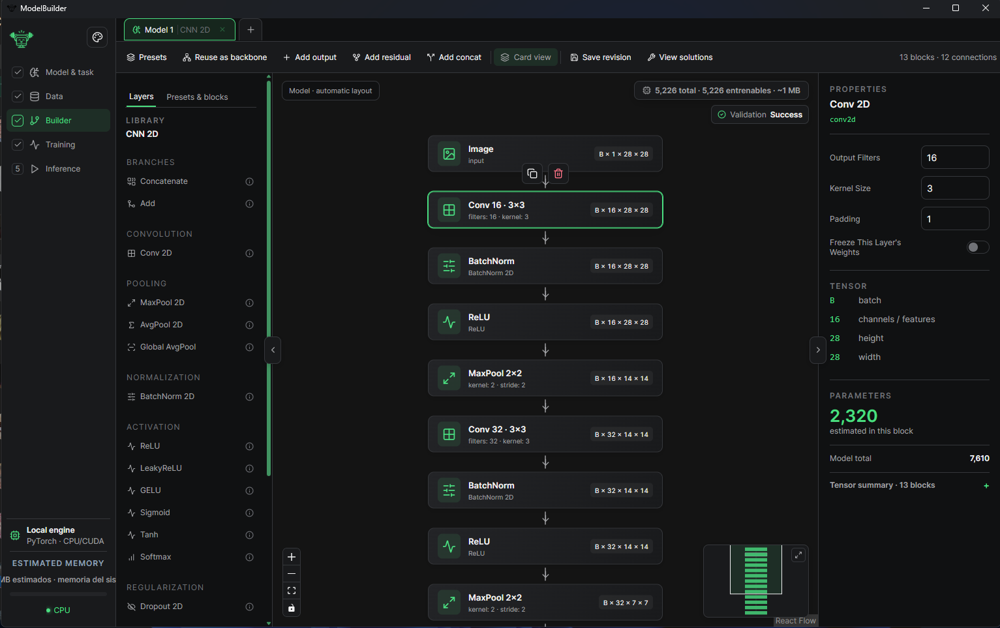
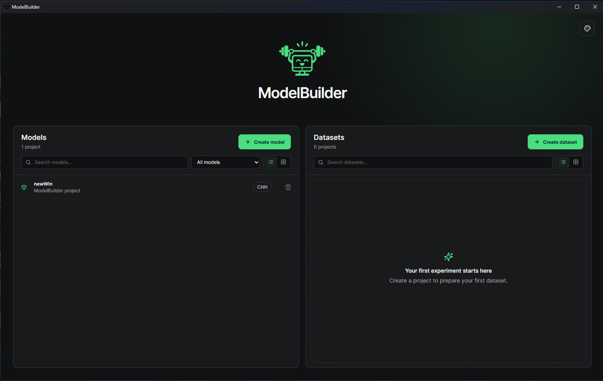
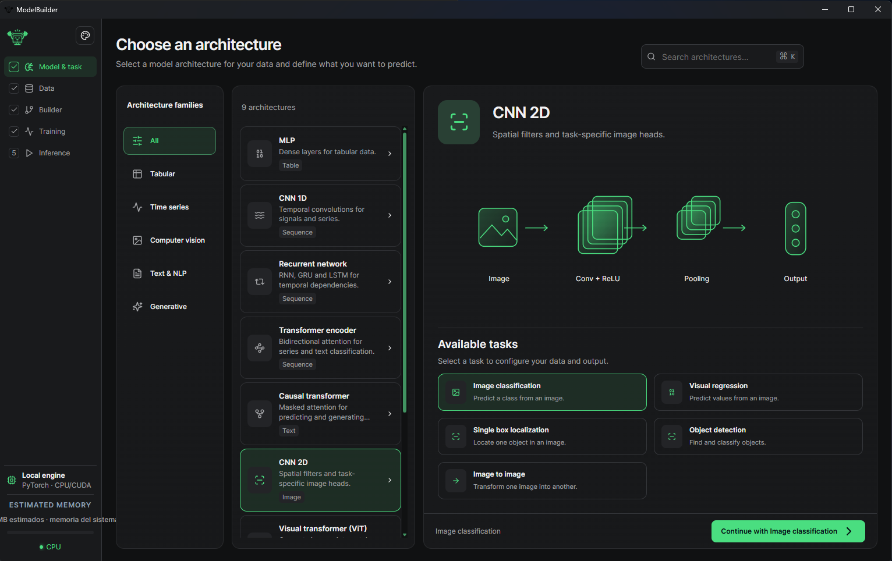
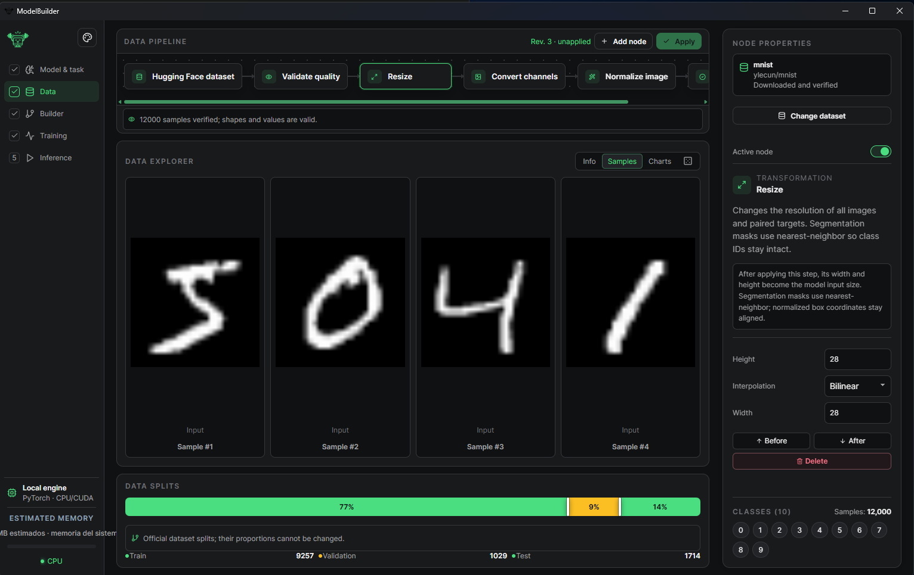
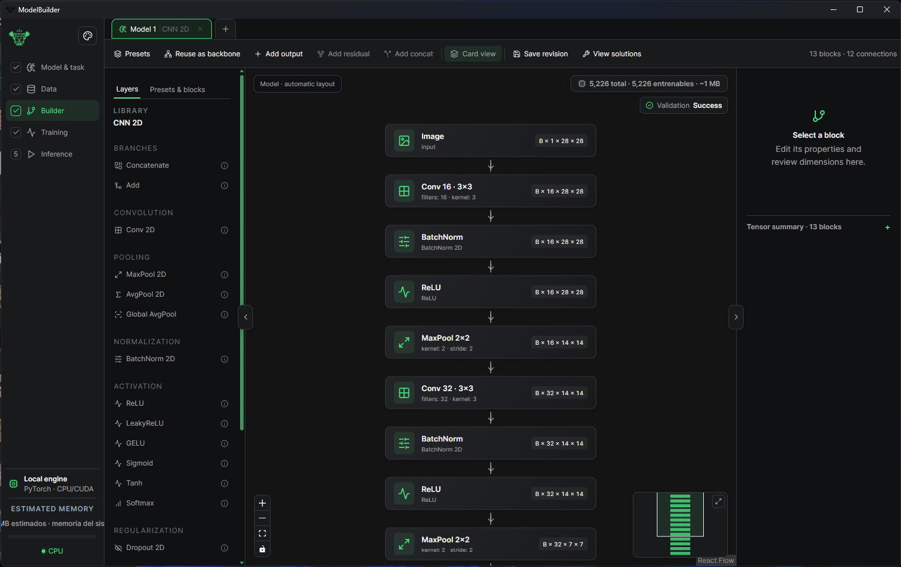
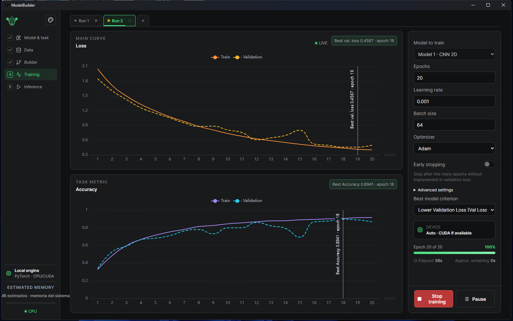
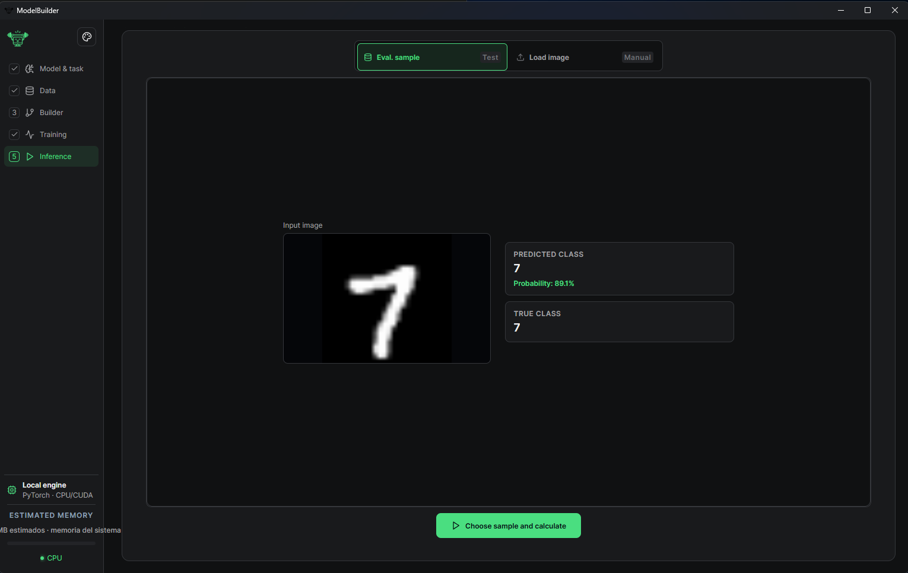

# ModelBuilder

Build, train, and test PyTorch models visually on your own computer. Prepare datasets, connect layers, follow training metrics, and try predictions in one workspace.

## Download the desktop app

**[Download ModelBuilder from GitHub Releases](https://github.com/Maxdesigna7x/Model_Builder/releases/latest)**

| Platform | Download |
| --- | --- |
| Windows x64 | `-setup.exe` installer or `.msi` package |
| Linux x86_64 | `.AppImage` or `.deb` for compatible Debian/Ubuntu-based distributions |

You do not need to install Python, Node.js, or Rust yourself. On first launch, choose **CPU or NVIDIA GPU** and let ModelBuilder download its private runtime. This needs Internet access and several GB of free disk space. NVIDIA requires a compatible GPU and CUDA 13.0-capable driver. Linux still needs a compatible system graphics stack; see [desktop setup and troubleshooting](docs/DESKTOP.md).

New builds check for updates. Windows and AppImage can install signed updates from the app; DEB users get a download link. Compatible Python environments and local projects are preserved across app updates. Older builds without the updater need one manual update first. Check each release's notes for its included features.

## What you can do

- **Prepare data:** import local files, use curated Hugging Face datasets, or import image-classification datasets from Kaggle.
- **Build models:** connect layers, inspect tensor shapes, create branches and residual connections, group blocks, and reuse presets or trained backbones.
- **Train locally:** use CPU or CUDA, follow training and validation curves, pause/resume runs, and keep checkpoints.
- **Fine-tune supported models:** use curated pretrained checkpoints, frozen backbones, gradual unfreezing, or LoRA where supported.
- **Test predictions:** inspect results for the selected task and checkpoint.
- **Curate image datasets:** import images/video frames, organize classes, edit boxes, review model proposals, and export classification or YOLO detection datasets.

Supported families include MLP, CNN 1D/2D, RNN/GRU/LSTM, Transformer encoder/causal, ViT, U-Net, and autoencoders. The app filters tasks by architecture. See the [user guide](docs/USER_GUIDE.md) for the supported workflows and boundaries.

Projects, datasets, checkpoints, and runtime files stay on your computer. Downloads from external services may require credentials or license acceptance.

## A look inside

The visual builder, with layer properties and tensor dimensions:



<details>
<summary>More screenshots: projects, data, training, and predictions</summary>

### Projects



### Architecture and task selection



### Data preparation



### Model graph



### Training



### Inference



</details>

## Documentation

- [User guide](docs/USER_GUIDE.md): datasets, model building, training, and inference.
- [Desktop guide](docs/DESKTOP.md): first launch, updates, storage, and Linux troubleshooting.
- [Development guide](docs/DEVELOPMENT.md): source setup, checks, and installer publishing.
- [Known limitations and remaining work](docs/LIMITATIONS.md).

## Run from source

For development, use Node.js 22.12+ and Python 3.12 with pip/venv. Desktop development also needs Rust and Tauri's native build dependencies. Downloaded apps do not require these developer tools.

```bash
git clone https://github.com/Maxdesigna7x/Model_Builder.git
cd Model_Builder
```

### Linux — local browser mode

```bash
python3.12 -m venv .venv
.venv/bin/python -m pip install -e '.[dev]'
npm ci
bash run-web.sh
```

### Windows — local browser mode

```powershell
py -3.12 -m venv .venv
.\.venv\Scripts\python.exe -m pip install -e '.[dev]'
npm ci
$env:MODELBUILDER_PYTHON = (Resolve-Path '.\.venv\Scripts\python.exe').Path
npm run dev
```

Open [localhost:1420](http://localhost:1420). The browser connects to the local Python backend; it does not upload your workspace to a hosted server.

For desktop development and building installers, follow the [development guide](docs/DEVELOPMENT.md).
